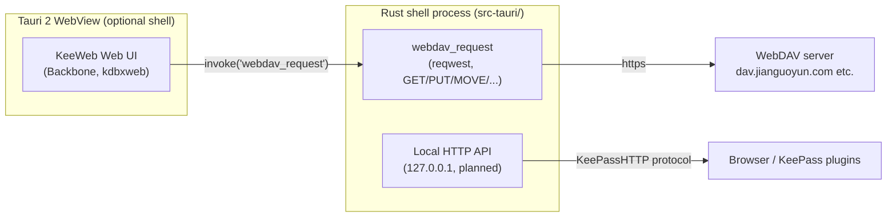

# KeeWeb Next

[中文](README.md) | **English**

A local-first KeePass client that runs in your system WebView — no Electron.
Open `.kdbx` databases over WebDAV (Nutstore / Nextcloud / any WebDAV server),
use the same database from desktop and phone, and let browser extensions and
KeePass plugins talk to it over a localhost HTTP API.

The upstream is [KeeWeb](https://github.com/keeweb/keeweb) (MIT). This
repository is an adaptation: **the Electron 13 desktop shell is gone**,
replaced by an optional Tauri 2 WebView shell (the NoteForge architecture),
and WebDAV requests are moved down into Rust.

---

## Why not build from scratch

| Candidate | WebDAV | PC + phone | Browser extension | Verdict |
| --- | --- | --- | --- | --- |
| **KeeWeb** (this upstream) | built in (XHR) | Electron desktop / phone browser | **KeeWeb Connect exists** | lowest cost, chosen |
| KeePassXC | none (needs OS mount) | desktop only | KeePassXC-Browser exists | no phone story |
| Keepass2Android / KeePassDX | yes | Android only | none | no desktop |
| KeeStone (Flutter) | yes (conditional writes) | yes | none | 4-month-old upstream, single maintainer |
| Ground-up rewrite | write it | write it | write it | KDBX parsing/merge/attachments/history is years of edge cases; silent data corruption is unacceptable |

KeeWeb already ships full KDBX 3.1/4.x read/write, **conflict-free merge**,
attachments, history, TOTP, and a published browser extension protocol. What
it lacks is three things, all fixed in this repository:

1. The Electron 13 shell → Tauri 2 (system WebView, ~10 MB binary).
2. WebDAV from a browser dies on CORS (Nutstore sends no CORS headers) →
   requests execute in Rust.
3. Upstream kdbxweb 2.0.4 (2021) → upgraded to 2.1.1 with 4.1 compatibility
   tests.

## Architecture



* **Web mode (no shell)**: `dist/` is a static site that runs in any browser;
  local files use the File System Access API, WebDAV is subject to browser
  CORS.
* **WebView mode (the default desktop form)**: Tauri 2 loads the same `dist/`
  and executes WebDAV through Rust `reqwest` — no CORS, no Node, no bundled
  Chromium.
* **Local HTTP API (in progress)**: the shell process serves a KeePassHTTP
  compatible endpoint on `127.0.0.1` so browser extensions and KeePass plugins
  can connect directly; the key exchange follows the KeePassHTTP
  test-associate / associate / get-logins / set-login flow (AES-256-CBC).

## Done (changes relative to upstream)

* Removed `desktop/`, Electron 13 and every electron/grunt packaging task;
  `package.json` no longer carries Electron, native-modules or
  native-messaging-host.
* Added `src-tauri/` (Tauri 2): loads `dist/` and exposes one command today,
  `webdav_request` (method whitelist GET/HEAD/PUT/POST/DELETE/MOVE/COPY/MKCOL/
  PROPFIND/OPTIONS, http/https only, 5-minute timeout, 512 MB cap, ≤5
  redirects).
* `storage-webdav.js` calls `invoke('webdav_request')` inside the shell; the
  response object keeps the XHR shape, so `Last-Modified` / 404 / 412
  semantics are unchanged.
* `kdbxweb` 2.0.4 → **2.1.1** (the git forks pako/xmldom replaced by registry
  packages).
* New browser tests (`test/src/util/kdbx-compat.js`): the KDBX 4.1 header
  KeePass 2.61 writes opens and saves; versions above 4.1 are refused.
  `npm test` is green (86 passing).
* Rust integration tests (`src-tauri/tests/webdav_mock.rs`): a local mock
  server proves the PUT carries `Content-Length` (not chunked), the Basic
  auth header, and the response headers/body round-trip.
* Arch packaging: `packaging/arch/PKGBUILD` (web app + shell binary).

## Not done yet / roadmap

* **Local HTTP API (KeePassHTTP compatible)** — next milestone, inside the
  shell process.
* Phone: the Tauri 2 Android/iOS targets (icons already generated) plus a
  round of mobile UI adaptation.
* Official browser-extension pairing for autofill (the KeeWeb Connect
  extension already works with web-mode postMessage).
* Auto-update, tray, global shortcuts, auto-type: Electron-era features, not
  migrated yet.

## Build

Requirements: Node ≥ 20, Rust, `webkit2gtk-4.1` (Linux),
`clang/cmake/ninja/pkgconf`.

```bash
# Web app (no shell)
npm ci --allow-git=all --allow-remote=all   # needed when your npmrc bans git sources
npm run build:web                            # output in dist/

# WebView shell
npm run build:shell                          # src-tauri/target/release/keeweb-next
npm run dev:shell                            # dev mode (start `npm run dev` on :8085 first)

# Tests
npm test                                     # browser tests (see CHROME_BIN below)
(cd src-tauri && cargo test)                 # Rust side
```

`npm test` launches puppeteer; with a system Chromium set
`CHROME_BIN=/usr/bin/chromium`.

## Install (Arch Linux)

```bash
cd packaging/arch
makepkg -si          # installs /usr/bin/keeweb-next and /usr/share/keeweb-next/dist
```

* WebView form: run `keeweb-next`.
* Browser form (without the webkit dependency):
  `/usr/share/keeweb-next/dist/index.html`.

## Nutstore (坚果云) configuration

Pick **WebDAV** on the KeeWeb open screen:

| Field | Value |
| --- | --- |
| URL | `https://dav.jianguoyun.com/dav/my-vault/db.kdbx` |
| Username | your Nutstore account email |
| Password | an **application password** (generated on the website under account security, not the login password) |

* The parent folder must exist; if the file does not, the first open creates it.
* Free accounts allow 600 WebDAV requests per 30 minutes; an open is one GET,
  a save is one PUT — well inside the limit.
* Known quirks: 411 (Content-Length required — shell PUTs satisfy it), 503
  (rate limited).

## Data and security

* The database is decrypted locally; WebDAV only ever carries ciphertext. The
  master password and key file are never written to disk.
* The shell's `webdav_request` allows only the methods WebDAV needs and only
  http/https; it is not a generic proxy.
* The future HTTP API binds `127.0.0.1` only, uses the KeePassHTTP pairing
  crypto, and requires explicit confirmation for the first connection.
* MIT, same as upstream; upstream docs live in
  [docs/README.upstream.md](docs/README.upstream.md).
