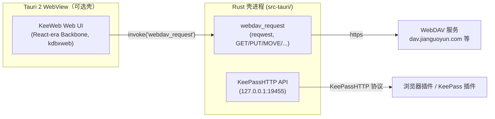
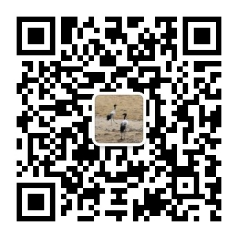

# KeeWeb Next

[中文](README.md) | [English](README.en.md)

本地优先（local-first）的 KeePass 密码库客户端，跑在系统自带的 WebView 里，没有 Electron。
通过 WebDAV 打开 `.kdbx`（坚果云 / Nextcloud / 任何 WebDAV 服务），电脑与手机用同一份数据库，
浏览器插件与 KeePass 插件通过本机 HTTP 接口直连。

上游是 [KeeWeb](https://github.com/keeweb/keeweb)（MIT）。本仓库是它的改造版：
**去掉了 Electron 13 桌面壳**，改为可选的 Tauri 2 WebView 壳（NoteForge 同款架构），
并把 WebDAV 请求下沉到 Rust 侧执行。

---

## 为什么不是从头写

| 候选 | WebDAV | PC + 手机 | 浏览器插件 | 结论 |
| --- | --- | --- | --- | --- |
| **KeeWeb**（本仓库上游） | 内建（XHR） | 桌面 Electron / 手机浏览器 | **KeeWeb Connect 已存在** | 改造成本最低 |
| KeePassXC | 无（需系统挂载） | 仅桌面 | KeePassXC-Browser 已有 | 手机无解 |
| Keepass2Android / KeePassDX | 有 | 仅 Android | 无 | 缺桌面 |
| KeeStone (Flutter) | 有（含条件写） | 有 | 无 | 上游仅 4 个月、单一维护者 |
| 从零自研 | 自己写 | 自己写 | 自己写 | KDBX 解析/合并/附件/历史等需要数年积累，数据损坏风险不可接受 |

KeeWeb 自带完整的 KDBX 3.1/4.x 读写、**conflict-free merge**、附件、历史、TOTP、
以及已经发布的浏览器扩展协议。缺的只有三件事，都是本仓库在补的：

1. Electron 13 壳 → 换成 Tauri 2（系统 WebView，二进制 ~10MB）。
2. 浏览器里 WebDAV 被 CORS 卡死（坚果云不返回 CORS 头）→ 请求下沉到 Rust。
3. 上游 kdbxweb 2.0.4（2021）→ 升级 2.1.1 并补 4.1 兼容测试。

## 架构



* **Web 模式（无壳）**：`dist/` 是纯静态站点，任何浏览器可跑；本地文件用
  File System Access API，WebDAV 受浏览器 CORS 限制。
* **WebView 模式（默认桌面形态）**：Tauri 2 加载同一份 `dist/`（`tauri://localhost`
  安全上下文，WebCrypto 可用），WebDAV 走 Rust `reqwest`，无 CORS 限制、无 Node、
  无 Chromium 捆绑。
* **本机 HTTP API**：壳进程在 `127.0.0.1:19455` 起 KeePassHTTP 兼容端点，
  浏览器插件/KeePass 插件直接对话；密钥配对沿用 KeePassHTTP 的
  test-associate / associate / get-logins / set-login 流程（AES-256-CBC）。

## 已完成（本仓库相对上游的改动）

* 移除 `desktop/`、Electron 13 与全部 electron/grunt 打包任务；
  `package.json` 中不再有 Electron / native-modules / native-messaging-host。
* 新增 `src-tauri/`（Tauri 2）：加载 `dist/`，提供 `webdav_request` 命令
  （方法白名单 GET/HEAD/PUT/POST/DELETE/MOVE/COPY/MKCOL/PROPFIND/OPTIONS，
  仅 http/https，5 分钟超时，512MB 上限，重定向 ≤5）。
* `storage-webdav.js` 在壳内走 `invoke('webdav_request')`，响应对象与 XHR 同形，
  `Last-Modified` / 404 / 412 语义保持不变。
* `kdbxweb` 2.0.4 → **2.1.1**（git fork 依赖 pako/xmldom 换成 registry 包）。
* 新增浏览器测试（`test/src/util/kdbx-compat.js`）：KeePass 2.61 写出的 KDBX 4.1
  可开可存；高于 4.1 的版本号被拒绝。`npm test` 全绿（86 passing）。
* Rust 集成测试（`src-tauri/tests/webdav_mock.rs`）：本地 mock 服务器验证
  PUT 带 `Content-Length`（非 chunked）、Basic 认证头、响应头/体回传。
* 补全壳的 `Launcher` API（窗口控制、剪贴板、配置存储、更新器置为禁用，
  仅 Node 可用的文件/auto-type 接口留空实现）；缺它就是白屏——启动时
  `Updater.init()` 抛 TypeError，页面停在空 body。
* 本地文件存储需要原生文件后端，壳内以 `fileStorageSupported` 显式关闭，
  离线缓存退回浏览器 IndexedDB 版本；另提供原生文件命令（读写/stat/mkdir/
  文件对话框），设置里的「另存为」、备份路径、选择密钥文件因此可用。
* 设置页全部可用并持久化到 `~/.local/share/info.keeweb.next/config/*.json`
  （主题、语言、自动锁定等）；Devices/YubiKey 需要原生 USB 模块与 `ykman`，
  壳内未实现，入口已关闭（`Launcher.devicesSupported = false`）。
* About 页改为本分支信息：KeeWeb Next 版本、维护者 Rossw、基于 KeeWeb 1.18.9
  （Antelle，MIT）。
* 插件仓库：`plugins/` 内置 5 个 KeeWeb 插件（快捷搜索、复制热键、打开 URL、
  密码年龄标记、重复项检查），画廊 `plugins.json`（jsDelivr 镜像，raw 作为回退）已签名并指向本仓库
  （`Links.Plugins`），签名方式见 `plugins/README.md`。
* 打开记录：最近 5 条保留在打开页，可点星标「收藏」置顶，收藏项不受 5 条上限裁剪。
* Arch 打包：`packaging/arch/PKGBUILD`（web + 壳二进制 + `plugins/` 与
  `browser-extension/` 离线副本）。

## 尚未完成 / 路线图

* 手机端：Tauri 2 的 Android/iOS 目标（图标已生成），UI 需要一轮移动端适配。
* 关联密钥的持久化（当前为进程内存储，重启后需重新配对；设计上不落盘）。
* 自动填充浏览器插件的官方对接（KeeWeb Connect 扩展已兼容 web 模式 postMessage；
  KeePassHTTP 端点已可用）。
* 自动更新、托盘、全局快捷键、auto-type：Electron 时代功能，暂未迁移。

## 浏览器集成（KeePassHTTP）

壳启动时会监听 `127.0.0.1:19455` 的 KeePassHTTP 端点，浏览器扩展可以用它填写/保存登录：

* **自带扩展**：`browser-extension/`（Manifest V3，Chrome/Edge/Chromium；Firefox 用
  同目录的 `manifest.firefox.json` 改名）。打开 `chrome://extensions` → 开发者模式 →
  「加载已解压的扩展程序」→ 选择该目录（Arch 包内路径
  `/usr/share/keeweb-next/browser-extension`），点扩展图标 →「Connect to the app」。
* **第三方扩展**：任何 KeePassHTTP 客户端都可以直连该端点，例如 chromeIPass、
  KeePassHttp-Connector。
* **KeePassXC-Browser 不支持**：它只走 KeePassXC 自己的 native messaging 协议，
  与本端点不兼容。
* 需要先解锁数据库；关联关系保存在壳进程内，重启应用后需重新确认一次。

## 本机 HTTP API（KeePassHTTP 兼容）

壳进程监听 `127.0.0.1:19455`，实现 KeePassHTTP 协议（pfn/keepasshttp），
现有浏览器插件无需修改即可连接：

* `associate`：插件提交 256-bit AES 密钥，**webview 内弹窗人工确认**后才会保存；
  返回的 Id 是密钥的 SHA-1。
* `test-associate` / `get-logins` / `get-logins-count` / `set-login`：
  全部使用共享密钥 + 每请求随机 Nonce 加密，Verifier 校验防重放。
* 数据库标识（Hash）随每个响应返回，插件可感知数据库更换。
* 安全边界：只绑 127.0.0.1、非回环连接直接丢弃、请求体 ≤1MB、
  读写超时 30s；关联密钥仅存进程内存，应用退出即失效；
  `get-logins` 只在库解锁时有结果，锁定时明确报 "database is locked"。

## 构建

依赖：Node ≥ 20、Rust、`webkit2gtk-4.1`（Linux）、`clang/cmake/ninja/pkgconf`。

```bash
# Web 应用（无壳）
npm ci --allow-git=all --allow-remote=all   # 本机 npmrc 禁 git 源时需要
npm run build:web                            # 产物在 dist/

# WebView 壳
npm run build:shell                          # src-tauri/target/release/keeweb-next
npm run dev:shell                            # 开发模式（先 npm run dev 起 :8085）

# 测试
npm test                                     # 浏览器测试（需要 CHROME_BIN，见下）
(cd src-tauri && cargo test)                 # Rust 侧
```

`npm test` 用 puppeteer 起浏览器；系统 Chromium 时设置 `CHROME_BIN=/usr/bin/chromium`。

## macOS 支持

壳是 Tauri 2 + 系统 WKWebView（不捆绑任何运行时，二进制 ~10MB）：

* 窗口使用 `titleBarStyle: Overlay` + `hiddenTitle`——红绿灯悬浮在内容之上，
  标题隐藏，与应用本体融为一体；`acceptFirstMouse` 让未聚焦窗口首击直达。
* 应用内标题栏（最小化/最大化/关闭）走 `window_minimize` /
  `window_toggle_maximize` / `window_close` 命令；macOS 上同样渲染。
* 拖拽：`titlebarStyle: hidden` 下的拖动条带带 `data-tauri-drag-region`。
* 图标：`icon.icns` 随包安装。
* 设置持久化在 `~/Library/Application Support/info.keeweb.next/config/`。
* CI 在 `macos-latest`（Apple Silicon）原生编译并出 dmg/app 包
  （`.github/workflows/build-next.yml`；Intel 版省略以省 macOS 分钟数）。

未迁移的 macOS 专属能力：Touch ID / 硬件加密存储（原 Electron
hardware-crypto）、auto-type、全局快捷键、托盘。

USB 设备 / YubiKey 同样未实现（原实现依赖 node-usb-detection、
node-yubikey-chalresp 与 `ykman` CLI），设置中的 Devices 页面已隐藏。

## 安装（Arch Linux）

```bash
cd packaging/arch
makepkg -si          # 装入 /usr/bin/keeweb-next 与 /usr/share/keeweb-next/dist
```

* WebView 形态：直接运行 `keeweb-next`。
* 自托管：`/usr/share/keeweb-next/dist` 是纯静态站点，用任意 web server 提供即可；
  本仓库不再附带 Docker 镜像文件（上游的 `package/docker*` 依赖外部基础镜像且
  无任何构建引用，已删除）。
* 浏览器形态（不装 webkit 依赖时）：`/usr/share/keeweb-next/dist/index.html`。

## 坚果云（Nutstore）配置

在 KeeWeb 打开界面选择 **WebDAV**：

| 字段 | 值 |
| --- | --- |
| URL | `https://dav.jianguoyun.com/dav/我的密码库/db.kdbx` |
| 用户名 | 坚果云账号邮箱 |
| 密码 | **应用密码**（官网「安全选项 → 添加应用密码」生成，不是登录密码） |

* 父目录需已存在；文件不存在时首次打开会创建。
* 免费账户 30 分钟内 600 次 WebDAV 请求；打开 1 次 GET、保存 1 次 PUT，日常足够。
* 上游已知 quirks：411（要求 Content-Length，壳内 PUT 已满足）、503（超限）。
* 服务器不返回 `Last-Modified` 时也能正常打开：此时不做基于版本的冲突检测，
  需要的话可在文件设置里启用「总是重新加载文件」。

## 支持与联系

如果这个项目帮你省了一点时间，欢迎请我喝一杯咖啡；也欢迎关注公众号获取更新。

| 微信收款码 | 微信公众号 |
| --- | --- |
|  |  |

邮件：<wangyantsing@qq.com>

## 数据与安全

* 数据库在本地解密；WebDAV 只传密文。主密码/密钥文件不落盘。
* 壳的 `webdav_request` 只允许 WebDAV 需要的方法与 http/https，不充当通用代理。
* HTTP API 只绑 `127.0.0.1`，沿用 KeePassHTTP 的配对加密，首次连接需人工确认。
* MIT，与上游一致；上游文档见 [docs/README.upstream.md](docs/README.upstream.md)。
