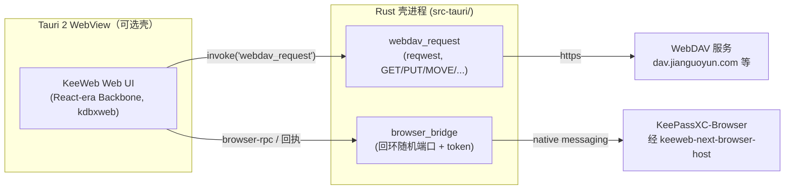

# KeeWeb Next

[中文](README.md) | [English](README.en.md)

本地优先（local-first）的 KeePass 密码库客户端，跑在系统自带的 WebView 里，没有 Electron。
通过 WebDAV 打开 `.kdbx`（坚果云 / Nextcloud / 任何 WebDAV 服务），电脑与手机用同一份数据库，
浏览器插件与 KeePass 插件通过本机 HTTP 接口直连。

上游是 [KeeWeb](https://github.com/keeweb/keeweb)（MIT）。本仓库是它的改造版：
**去掉了 Electron 13 桌面壳**，改为可选的 Tauri 2 WebView 壳（NoteForge 同款架构），
并把 WebDAV 请求下沉到 Rust 侧执行。

---

## 为什么不是从头写

| 候选 | WebDAV | PC + 手机 | 浏览器插件 | 结论 |
| --- | --- | --- | --- | --- |
| **KeeWeb**（本仓库上游） | 内建（XHR） | 桌面 Electron / 手机浏览器 | **KeeWeb Connect 已存在** | 改造成本最低 |
| KeePassXC | 无（需系统挂载） | 仅桌面 | KeePassXC-Browser 已有 | 手机无解 |
| Keepass2Android / KeePassDX | 有 | 仅 Android | 无 | 缺桌面 |
| KeeStone (Flutter) | 有（含条件写） | 有 | 无 | 上游仅 4 个月、单一维护者 |
| 从零自研 | 自己写 | 自己写 | 自己写 | KDBX 解析/合并/附件/历史等需要数年积累，数据损坏风险不可接受 |

KeeWeb 自带完整的 KDBX 3.1/4.x 读写、**conflict-free merge**、附件、历史、TOTP、
以及已经发布的浏览器扩展协议。缺的只有三件事，都是本仓库在补的：

1. Electron 13 壳 → 换成 Tauri 2（系统 WebView，二进制 ~10MB）。
2. 浏览器里 WebDAV 被 CORS 卡死（坚果云不返回 CORS 头）→ 请求下沉到 Rust。
3. 上游 kdbxweb 2.0.4（2021）→ 升级 2.1.1 并补 4.1 兼容测试。

## 架构



* **Web 模式（无壳）**：`dist/` 是纯静态站点，任何浏览器可跑；本地文件用
  File System Access API，WebDAV 受浏览器 CORS 限制。
* **WebView 模式（默认桌面形态）**：Tauri 2 加载同一份 `dist/`（`tauri://localhost`
  安全上下文，WebCrypto 可用），WebDAV 走 Rust `reqwest`，无 CORS 限制、无 Node、
  无 Chromium 捆绑。
* **浏览器集成**：只走 native messaging。浏览器扩展把消息交给
  `keeweb-next-browser-host` 助手，助手再通过回环随机端口 + 一次性 token 转给
  壳进程；**不再监听 `19455` 之类的固定端口，也没有 HTTP 端点**。

## 已完成（本仓库相对上游的改动）

* 移除 `desktop/`、Electron 13 与全部 electron/grunt 打包任务；
  `package.json` 中不再有 Electron / native-modules / native-messaging-host。
* 新增 `src-tauri/src/browser_bridge.rs`：native messaging 桥。助手
  （`keeweb-next-browser-host`）连回环随机端口，首行是一次性 token；
  请求转成 `browser-rpc` 事件交给 webview 的协议实现，回执走
  `browser_rpc_reply`。端口与 token 写在用户私有目录的 `endpoint.json`
  （Unix 0600），并发连接与帧大小都有上限。
* 新增 `src-tauri/`（Tauri 2）：加载 `dist/`，提供 `webdav_request` 命令
  （方法白名单 GET/HEAD/PUT/POST/DELETE/MOVE/COPY/MKCOL/PROPFIND/OPTIONS，
  仅 http/https，5 分钟超时，512MB 上限，重定向 ≤5）。
* `storage-webdav.js` 在壳内走 `invoke('webdav_request')`，响应对象与 XHR 同形，
  `Last-Modified` / 404 / 412 语义保持不变。
* `kdbxweb` 2.0.4 → **2.1.1**（git fork 依赖 pako/xmldom 换成 registry 包）。
* 新增浏览器测试（`test/src/util/kdbx-compat.js`）：KeePass 2.61 写出的 KDBX 4.1
  可开可存；高于 4.1 的版本号被拒绝。`npm test` 全绿（86 passing）。
* Rust 集成测试（`src-tauri/tests/webdav_mock.rs`）：本地 mock 服务器验证
  PUT 带 `Content-Length`（非 chunked）、Basic 认证头、响应头/体回传。
* 补全壳的 `Launcher` API（窗口控制、剪贴板、配置存储、更新器置为禁用，
  仅 Node 可用的文件/auto-type 接口留空实现）；缺它就是白屏——启动时
  `Updater.init()` 抛 TypeError，页面停在空 body。
* 本地文件存储需要原生文件后端，壳内以 `fileStorageSupported` 显式关闭，
  离线缓存退回浏览器 IndexedDB 版本；另提供原生文件命令（读写/stat/mkdir/
  文件对话框），设置里的「另存为」、备份路径、选择密钥文件因此可用。
* 设置页全部可用并持久化到 `~/.local/share/info.keeweb.next/config/*.json`
  （主题、语言、自动锁定等）；Devices/YubiKey 需要原生 USB 模块与 `ykman`，
  壳内未实现，入口已关闭（`Launcher.devicesSupported = false`）。
* About 页改为本分支信息：KeeWeb Next 版本、维护者 Rossw、基于 KeeWeb 1.18.9
  （Antelle，MIT）。
* 插件仓库：`plugins/` 内置 5 个 KeeWeb 插件（快捷搜索、复制热键、打开 URL、
  密码年龄标记、重复项检查），画廊 `plugins.json`（jsDelivr 镜像，raw 作为回退）已签名并指向本仓库
  （`Links.Plugins`），签名方式见 `plugins/README.md`。
* 打开记录：最近 5 条保留在打开页，可点星标「收藏」置顶，收藏项不受 5 条上限裁剪。
* WebDAV 连接信息随记录保存（数据库 uuid 参与的混淆密码），再次打开时自动回填
  URL、用户名与密码，无需重输；保存密码可在配置里的「Remember password」取消。
* 密钥文件默认按路径记住，再次打开自动读取；密码输入框旁的「Remember key file」
  可随时关闭。壳内读取密钥文件走与数据库相同的本地文件通道。
* Arch 打包：`packaging/arch/PKGBUILD`（web + 壳二进制 + `plugins/` 离线副本）。

## 尚未完成 / 路线图

* 手机端：Tauri 2 的 Android/iOS 目标（图标已生成），UI 需要一轮移动端适配；
  与桌面壳差异较大，暂未进入本分支的发布流程。
* 自动填充浏览器插件的官方对接（KeePassXC-Browser 走 native messaging 已可用）。
* 自动更新、全局快捷键、auto-type：Electron 时代功能，暂未迁移。

## 浏览器集成

只有一种方式：native messaging。KeePassHTTP 端点与其自带扩展已移除，应用不监听
任何固定端口。

### KeePassXC-Browser

壳启动时为主流浏览器写入 `org.keepassxc.keepassxc_browser` 的主机清单，
指向随包分发的 `keeweb-next-browser-host` 助手；扩展按常规流程连接即可。
若机器上同时装了 KeePassXC，同名清单会被最后安装的一方覆盖。

* Linux：`~/.config/<浏览器>/NativeMessagingHosts` 与
  `~/.mozilla/native-messaging-hosts`。
* macOS：`~/Library/Application Support/{<浏览器>,Mozilla}/…`。
* Windows：清单写到 `%APPDATA%\KeeWeb Next\native-hosts`，并在
  `HKCU\Software\{Google\Chrome,Chromium,Microsoft\Edge,BraveSoftware\Brave-Browser,Vivaldi}\NativeMessagingHosts`
  与 `HKCU\Software\Mozilla\NativeMessagingHosts` 注册同一个 host 名。

助手和主程序通过 `127.0.0.1` 上的随机端口通信；端口与一次性 token 写在
仅当前用户可读的 endpoint 文件里（Unix 0600），浏览器进程只负责转发消息。

* 关联（association）与 `get-databasehash` 不要求已解锁数据库，和 KeePassXC 一致，
  扩展首次连接即可完成关联；只有真正读写条目的动作才要求数据库已解锁。
* `get-logins` 返回该站点**全部**匹配条目（上限 30），与 KeePassXC 一致：扩展据此判断
  页面提交的账号是否已知，不会把刚读出来的密码再提示“保存”一遍（否则会产生重复条目）；
  多账号时在扩展自己的弹窗里挑选，而不是在应用窗口里弹选择框。
* 授权弹窗可勾选「记住此选择，不再询问」，写入 `app-settings.json`，重启后不再询问；
  设置 → 浏览器集成 里可随时修改或清除。
* 「在返回密码前询问」的选项含义：**总是询问（即使只匹配一个条目）** 会在每个网站都
  弹出选条目的框；默认「仅在匹配到多个条目时」则单个匹配直接填充、完全不弹窗。

#### 通行密钥（passkey / WebAuthn）

应用报告的 KeePassXC 版本是 `2.7.7`，这是扩展判断「可以发哪些动作」的依据
（`KnownAppVersions.KeePassXC`）。支持范围：

| 动作 | 说明 |
| --- | --- |
| `passkeys-register` | 网站注册通行密钥：应用生成 P-256 密钥对，签名后把公钥交给网站 |
| `passkeys-get` | 网站用通行密钥登录：应用用保存的私钥签名 challenge |

* 私钥、credential ID、user handle 与依赖方存进独立条目（标题 `<站点> (Passkey)`），
  字段沿用 KeePassXC 的 `KPEX_PASSKEY_*` 命名，因此**同一个数据库在 KeePassXC 与
  KeePassXC-Browser 之间可互认**；私钥与 credential ID 是受保护字段。
* 新建的通行密钥条目放在 `Browser` 分组（没有就创建），与密码条目同一个地方。
  这些条目不会出现在 `get-logins` 结果或字段选择框里：它们没有密码，
  凭证材料只经由通行密钥动作输出。
* 注册与登录都要在应用里确认一次；同一依赖方有多个通行密钥时改为弹出条目选择框。
  确认框显示经过校验的依赖方与标准化后的页面来源，不显示页面自报的站点名。
  同一时刻只允许一个确认框：页面并发触发多个 `get()` 时，后到的请求直接拒绝，
  避免堆叠的确认框让一次点击批准多次签名。确认框关闭后会重新解析条目，
  确认期间被删除、禁用或移入回收站的通行密钥不会再签名。
* 校验在应用侧完成，不信任页面：默认只接受 `https` 来源（可在
  设置 → 浏览器集成 里放开 `http://localhost`），`rpId` 必须是来源的有效域名或
  它的**可注册**父域；是否可注册由公共后缀列表（`tldts`，含 `github.io`、
  `s3.amazonaws.com` 一类的私有后缀）判定，因此租户站点不能冒充同一后缀下的
  其他站点。裸 TLD、公共后缀与 IP 字面量一律拒绝，域名末尾的点会先归一化。
  challenge 至少 16 字节、user id 1–64 字节。
* 断言**不置 UV 位**：用户按下「允许」只是 presence，不是生物特征/PIN 验证。
  站点要求 `userVerification: 'required'` 时会明确报错，而不是谎报已验证。
* 只实现 ES256（P-256 + SHA-256）与 `fmt: none` 的 attestation。要求
  `attestation: direct`、或只提供 RS256/EdDSA 的站点无法使用。

## 托盘

桌面版启动后常驻系统托盘：左键点击显示/隐藏主窗口，右键菜单可以显示/隐藏或退出；
关闭主窗口时默认隐藏到托盘，而不是退出。Linux 需要 `libayatana-appindicator3`，
CI 的 Linux 依赖步骤已经安装。

## 构建

依赖：Node 24 LTS、Rust、`webkit2gtk-4.1`（Linux）、`clang/cmake/ninja/pkgconf`。
注意 Node 26 的 npm 11 会以 allow-scripts 拒绝本仓库的 git 依赖安装，
Node 24 LTS 实测可用；macOS 一键脚本 `build-macos.sh` 已内置该版本处理。

```bash
# Web 应用（无壳）
npm ci --allow-git=all --allow-remote=all   # 本机 npmrc 禁 git 源时需要
npm run build:web                            # 产物在 dist/

# WebView 壳
node scripts/prepare-browser-host.mjs        # 生成 externalBin 助手
npm run build:shell                          # src-tauri/target/release/keeweb-next
npm run dev:shell                            # 开发模式（先 npm run dev 起 :8085）

# 测试
npm test                                     # 浏览器测试（需要 CHROME_BIN，见下）
(cd src-tauri && cargo test)                 # Rust 侧
```

`npm test` 用 puppeteer 起浏览器；系统 Chromium 时设置 `CHROME_BIN=/usr/bin/chromium`。

## macOS 支持

壳是 Tauri 2 + 系统 WKWebView（不捆绑任何运行时，二进制 ~10MB）：

* 窗口使用 `titleBarStyle: Overlay` + `hiddenTitle`——红绿灯悬浮在内容之上，
  标题隐藏，与应用本体融为一体；`acceptFirstMouse` 让未聚焦窗口首击直达。
* 应用内标题栏（最小化/最大化/关闭）走 `window_minimize` /
  `window_toggle_maximize` / `window_close` 命令；macOS 上同样渲染。
* 拖拽：`titlebarStyle: hidden` 下的拖动条带带 `data-tauri-drag-region`。
* 图标：`icon.icns` 随包安装。
* 设置持久化在 `~/Library/Application Support/info.keeweb.next/config/`。
* CI 在 `macos-latest`（Apple Silicon）原生编译并出 dmg/app 包
  （`.github/workflows/build-next.yml`；Intel 版省略以省 macOS 分钟数）。

未迁移的 macOS 专属能力：Touch ID / 硬件加密存储（原 Electron
hardware-crypto）、auto-type、全局快捷键。

USB 设备 / YubiKey 同样未实现（原实现依赖 node-usb-detection、
node-yubikey-chalresp 与 `ykman` CLI），设置中的 Devices 页面已隐藏。

## 安装（Arch Linux）

```bash
cd packaging/arch
makepkg -si          # 装入 /usr/bin/keeweb-next 与 /usr/share/keeweb-next/dist
```

* WebView 形态：直接运行 `keeweb-next`。
* 自托管：`/usr/share/keeweb-next/dist` 是纯静态站点，用任意 web server 提供即可；
  本仓库不再附带 Docker 镜像文件（上游的 `package/docker*` 依赖外部基础镜像且
  无任何构建引用，已删除）。
* 浏览器形态（不装 webkit 依赖时）：`/usr/share/keeweb-next/dist/index.html`。

## 坚果云（Nutstore）配置

在 KeeWeb 打开界面选择 **WebDAV**：

| 字段 | 值 |
| --- | --- |
| URL | `https://dav.jianguoyun.com/dav/我的密码库/db.kdbx` |
| 用户名 | 坚果云账号邮箱 |
| 密码 | **应用密码**（官网「安全选项 → 添加应用密码」生成，不是登录密码） |

* 父目录需已存在；文件不存在时首次打开会创建。
* 免费账户 30 分钟内 600 次 WebDAV 请求；打开 1 次 GET、保存 1 次 PUT，日常足够。
* 上游已知 quirks：411（要求 Content-Length，壳内 PUT 已满足）、503（超限）。
* 服务器不返回 `Last-Modified` 时也能正常打开：此时不做基于版本的冲突检测，
  需要的话可在文件设置里启用「总是重新加载文件」。

## 支持与联系

如果这个项目帮你省了一点时间，欢迎请我喝一杯咖啡；也欢迎关注公众号获取更新。

| 微信收款码 | 微信公众号 |
| --- | --- |
|  |  |

邮件：<wangyantsing@qq.com>

## 数据与安全

* 数据库在本地解密；WebDAV 只传密文。主密码/密钥文件不落盘。
* 壳的 `webdav_request` 只允许 WebDAV 需要的方法与 http/https，不充当通用代理。
* 浏览器集成只走 native messaging，不监听任何固定端口；助手与壳之间是回环随机
  端口 + 一次性 token（文件 0600），网页无法访问。
* MIT，与上游一致；上游文档见 [docs/README.upstream.md](docs/README.upstream.md)。
